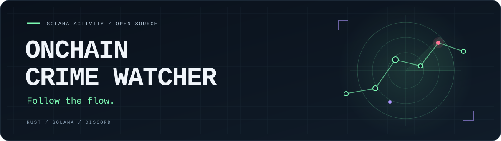
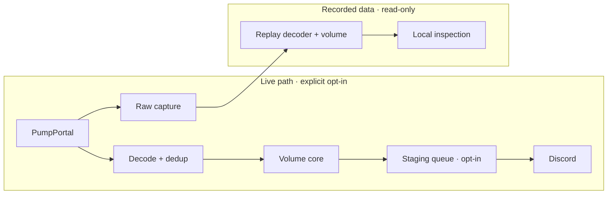

<p align="center">
  
</p>

<h1 align="center">Onchain Crime Watcher</h1>
<p align="center">A Rust engine for Solana token activity and Discord alerts.</p>

<p align="center">
  <a href="https://github.com/dotkoms/onchain-crime-watcher/actions/workflows/ci.yml"></a>
  <a href="Cargo.toml"></a>
  <a href="LICENSE"></a>
  <a href="#project-status"></a>
</p>

<p align="center">
  <a href="#quickstart">Quickstart</a> ·
  <a href="#whats-built">What's built</a> ·
  <a href="#architecture">Architecture</a> ·
  <a href="#roadmap">Roadmap</a> ·
  <a href="#contributing">Contributing</a>
</p>

---

**Track the launch stream. Detect unusual volume. Deliver concise alerts with their coverage limits attached.**

Onchain Crime Watcher is an open-source research project for the pump.fun ecosystem. It collects real events, evaluates volume anomalies, and can deliver alerts to an explicitly configured Discord staging channel. Community takeovers, bundle tracking, and wallet signals are part of the roadmap.

## Project status

**Core implemented. Live acceptance in progress.**

Starting without arguments reports `waiting_for_data` and exits. Provider connections, paid subscriptions, staging delivery, and reconnect attempts require deliberate opt-in. The app does not generate demo trades or sample signals.

Production delivery remains off while provider coverage, billing, Discord acceptance, and signal quality are validated. See the [task list](tasks/todo.md) for progress and [SCOPE.md](SCOPE.md) for the product contract.

## What's built

| Component | Current capability |
| --- | --- |
| Real-event collection | One PumpPortal socket; free create/migration events and an opt-in paid observation of one mint. |
| Exact amounts | Integer raw-unit decoding, bounded deduplication, and explicit accounting for unresolved SOL amounts. |
| Volume analysis | Create-anchored buckets, trimmed baselines, participation and concentration gates, and a labelled cold-baseline path. Thresholds remain unvalidated priors. |
| Recorded captures | Bounded, compressed, checksummed capture with loss accounting, checked shutdown, and read-only diagnostic inspection/replay. |
| Guarded staging delivery | Expiring candidates, delivery budgets, durable reservations, and no automatic retry after an ambiguous POST. |
| Bounded recovery | Optional free-only reconnects, finite retry budgets, transport/application liveness, and bounded pipeline panic recovery. |
| Local visibility | Loopback health endpoint, spend accounting, connection generations, and failure counters. |

## Quickstart

Requires **Rust 1.92+** on Linux or macOS.

```sh
git clone https://github.com/dotkoms/onchain-crime-watcher.git
cd onchain-crime-watcher

cargo build --workspace --locked
cargo run --locked
cargo run --locked -- --config config/example.toml --check-config
```

No wallet or API credentials are needed for these commands. Default startup stays disconnected and creates no application data directory. Cargo may download dependencies on the first build.

### Work with real recorded data

If you already have a capture from the collector:

```sh
cargo run --locked -- --inspect-capture /path/to/real.capture
cargo run --locked -- --replay-capture /path/to/real.capture --json
```

Inspection is read-only. Replay uses recorded time and the same volume core; it does not invent missing history or send alerts. This is a diagnostic tool, with a complete decision-replay and backtesting harness still planned. See [working with real data](docs/real-data.md).

### Connect when ready

```sh
cp config/example.toml config/local.toml

# Inspect the configuration and connection plan without connecting.
cargo run --locked -- --config config/local.toml --dry

# Deliberately start a short, free-event collection session.
cargo run --locked -- --live --config config/local.toml --run-for-secs 30
```

While live, health is available at `http://127.0.0.1:9898/health`. Capture defaults require a 2 GiB free-space floor. Keep local settings in the ignored `config/local.toml`; the app does not automatically load `.env` files.

Additional capabilities have separate setup:

- **Paid mint observation:** configure `OCW_PUMPPORTAL_KEY`, initialize the spend ledger with `--init-spend-ledger`, and opt in with `--enable-paid`. Follow the [collector runbook](docs/m1a.md) for the complete setup. Local spend bounds are not an upstream billing cap; in-flight billing exposure still needs measurement.
- **Discord staging:** configure `OCW_DISCORD_STAGING_URL`, the expected staging channel ID, and `--enable-staging-delivery`. See [staging delivery](docs/staging-delivery.md) for validation, budgets, and acceptance checks.
- **Reconnects:** disabled by default. Optional [bounded recovery](docs/recovery.md) retries free collection only; paid observation never resumes automatically.

**No wallet signing key is required.**

## Architecture

One binary, one library, bounded state throughout the data path.



```text
crates/
├── ocw/        CLI, configuration, mode selection, shutdown
└── ocw-core/   Feed, volume, delivery, recovery, spend, capture/replay
```

Receive time anchors observation. Unknown amounts stay unresolved, capture loss is counted, and suspected application stalls suppress alerts. Coverage remains **single-source unverified**: a healthy socket does not prove a complete event stream.

## Roadmap

| Area | Where it stands |
| --- | --- |
| Collector, volume core, staging sender | Implemented; live provider and Discord acceptance remain pending. |
| Reliability | Transport recovery, current-stage crash containment, heartbeat/readiness and opt-in external monitoring implemented. Independent probes, gap healing, full task topology and checkpoint work remain. |
| Replay and validation | Diagnostic capture inspection exists. Complete decision replay, backtests, and production evidence gates remain. |
| Community takeovers and bundles | Planned. Feed claims and incomplete launch coverage must be stated explicitly. |
| Wallet discovery and exits | Planned. Requires observed positions, cost basis, and coverage-aware accounting. |
| Secondary provider | Planned. Warm standby and feed comparison are specified, not implemented. |

The full signal definitions and limits live in [SCOPE.md](SCOPE.md). The [backtesting plan](docs/backtest.md) describes the evidence required before production delivery.

## Documentation

| Build and operate | Understand the design |
| --- | --- |
| [Real-data workflow](docs/real-data.md) | [Volume signals](docs/volume.md) |
| [Collector setup](docs/m1a.md) | [Feed and coverage](docs/feed.md) |
| [Staging delivery](docs/staging-delivery.md) | [Delivery contract](docs/delivery.md) |
| [Recovery](docs/recovery.md) · [Supervision](docs/supervision.md) · [Shutdown](docs/shutdown.md) | [Replay and backtesting](docs/backtest.md) |
| [Monitoring setup](docs/monitoring.md) · [Quality constraints](CONSTRAINTS.md) | [Failover plan](docs/failover.md) |
| [Task list](tasks/todo.md) | [References](docs/references.md) |

## Contributing

Small, focused contributions are welcome: decoder fixes, capture integrity checks, fault handling, documentation, and evidence about real feed coverage. Check the [task list](tasks/todo.md) and [open an issue](https://github.com/dotkoms/onchain-crime-watcher/issues) before starting a larger feature.

Read [SCOPE.md](SCOPE.md) and [CONSTRAINTS.md](CONSTRAINTS.md), then run the repository checks:

```sh
cargo fmt --all -- --check
cargo clippy --workspace --all-targets --locked -- -D warnings
cargo test --workspace --locked
cargo build --workspace --locked
```

Keep credentials and private captures out of pull requests. Artificial inputs belong in isolated tests; application behavior and signal claims must stay grounded in real observations. State what you verified and what still needs live acceptance.

## License

[MIT](LICENSE) · Built by [dotkoms](https://github.com/dotkoms).
